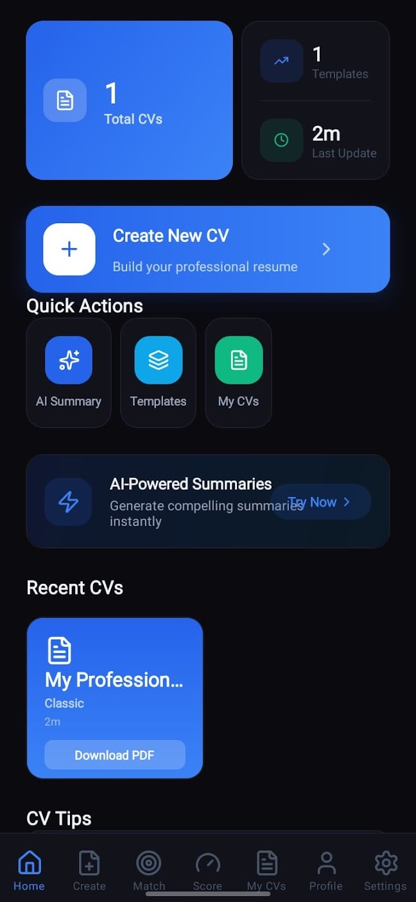
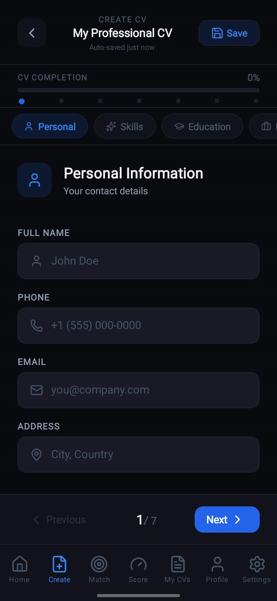
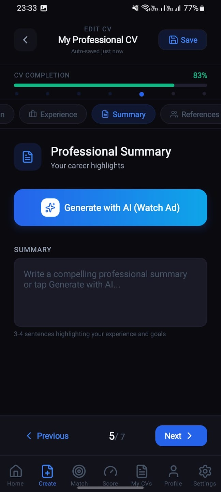
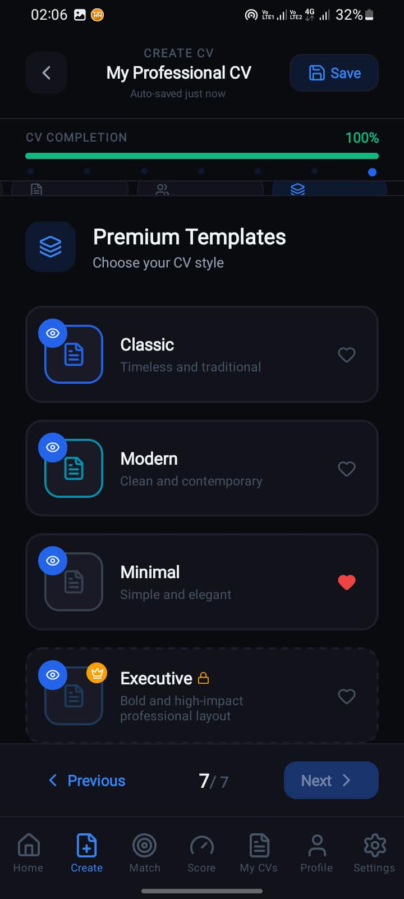
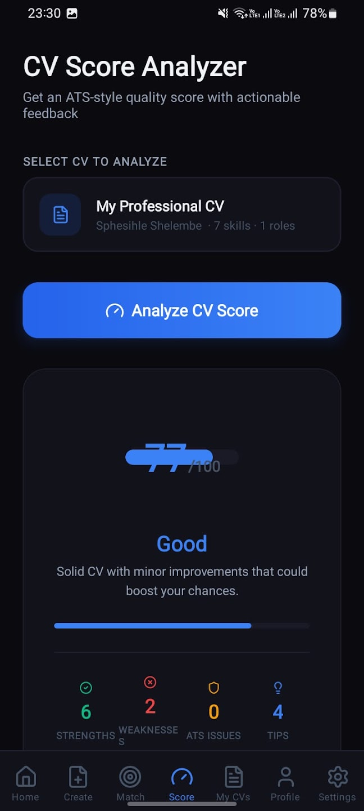
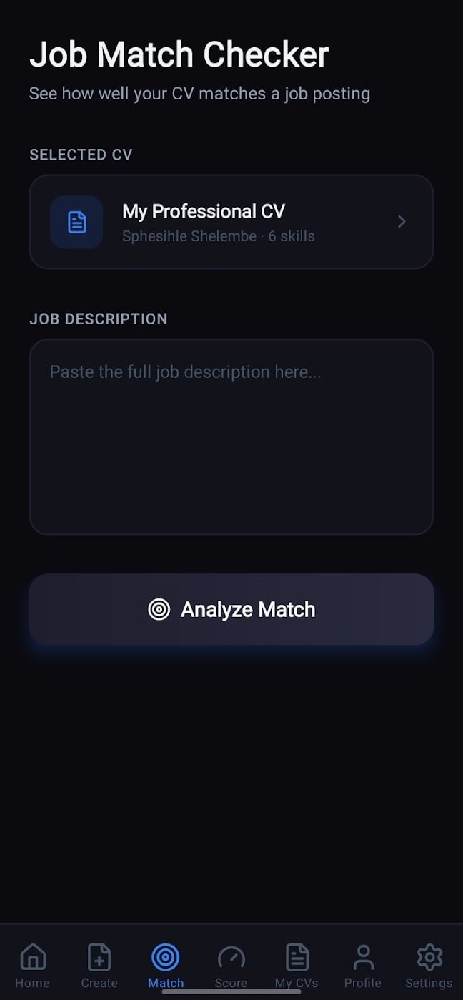

# 📄 CV Builder

<p align="center">
  
  
  
  
</p>

> Build professional resumes anytime, anywhere.

CV Builder is a modern Android application developed by **Shelembe Studios** that enables users to create, manage, and export professional CVs directly from their mobile device. The application provides an intuitive interface for organizing personal information, education, work experience, skills, certifications, and other essential resume sections while allowing users to generate polished PDF documents suitable for job applications.

Designed with simplicity and performance in mind, CV Builder helps job seekers create high-quality resumes without requiring a desktop computer or complex editing software.

---

## ✨ Features

* Secure user authentication
* Create and manage multiple CVs
* Professional CV editor
* Edit personal information
* Add education history
* Add work experience
* Add technical and soft skills
* Manage certifications and achievements
* Real-time CV preview
* Export resumes as PDF
* Local and cloud data storage
* Responsive mobile-first interface

---

<p align="center">
  
  
  
  
  
  
</p>

---

## 🛠 Technology Stack

### Frontend

* React Native
* Expo
* Expo Router
* TypeScript

### Backend

* Supabase
* PostgreSQL
* Row Level Security (RLS)

### PDF Generation

* Expo Print
* Expo File System

### Development Tools

* Visual Studio Code
* Git
* GitHub
* Android Studio

---

## 🏗 Project Structure

```
CVBuilder/
│
├── app/
├── assets/
├── components/
├── constants/
├── hooks/
├── services/
├── types/
├── utils/
├── supabase/
├── package.json
└── README.md
```

---

## 🚀 Getting Started

### Prerequisites

Before running the project, ensure the following are installed:

* Node.js
* npm
* Git
* Android Studio (recommended)
* Expo CLI (optional)

---

### Installation

Clone the repository

```bash
git clone https://github.com/yourusername/cvbuilder.git
```

Navigate to the project

```bash
cd cvbuilder
```

Install dependencies

```bash
npm install
```

Start the development server

```bash
npx expo start
```

Run on Android

```bash
npx expo run:android
```

---

## 🔐 Authentication

CV Builder uses **Supabase Authentication** for secure user registration and login.

User data is protected through:

* Row Level Security (RLS)
* Secure authentication
* Individual user data isolation

---

## 📄 PDF Export

Users can generate professional PDF resumes directly from the application.

Generated PDFs preserve:

* Professional formatting
* Typography
* Section ordering
* Clean layout suitable for employers

---

## 🎯 Project Goals

CV Builder was built to:

* Simplify CV creation
* Improve accessibility for job seekers
* Deliver professional-quality resumes
* Provide an intuitive mobile experience
* Eliminate the need for desktop resume software

---

## 🔮 Roadmap

Planned improvements include:

* Multiple professional templates
* AI-powered resume suggestions
* Cover letter generator
* Resume scoring
* Cloud synchronization
* ATS optimization
* Multi-language support
* Dark mode improvements

---

## 🤝 Contributing

Contributions, suggestions, and feature requests are welcome.

If you would like to contribute:

1. Fork the repository.
2. Create a feature branch.
3. Commit your changes.
4. Open a Pull Request.

---

## 📜 License

This project is licensed under the MIT License.

---

## 👨‍💻 Developer

**Sphesihle Shelembe**

Founder & Software Developer

**Shelembe Studios**

Building software that empowers people through simple, modern, and reliable technology.

---

## ⭐ Support

If you found this project useful, consider giving it a ⭐ on GitHub. Your support helps the project grow and motivates future development.

---

> © 2026 Shelembe Studios. All rights reserved.
